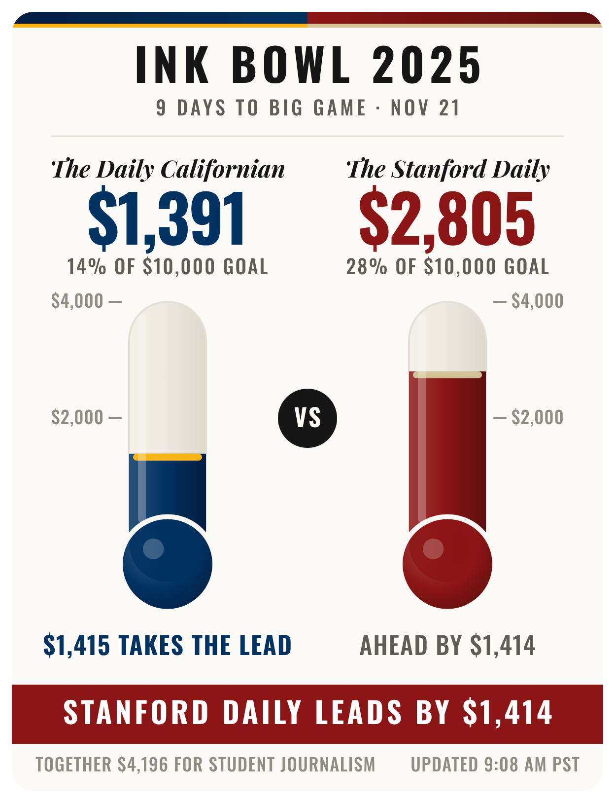

# Ink Bowl thermometer

A live **Daily Cal vs. Stanford Daily** fundraising thermometer for the Ink Bowl,
served from a Cloudflare Worker. One image URL, embeddable on both papers'
Givebutter campaign pages, any web page, and (as a PNG) in email.



- Reads each paper's total from its **public Givebutter campaign page** — no API key
  needed from either side. If a paper does share a Givebutter API key, that side
  switches to the API automatically; the two sides are independent.
- One **shared scale keyed to the leader**, so the taller tube is always the side
  that's ahead, with the gap stated as an actionable number under the trailing side
  (`$1,415 TAKES THE LEAD`), a Big Game countdown, and a combined total.
- **Mobile-first**: designed for the ~340px a phone gives a Givebutter story image.
- Never goes blank: a failed read serves the last good number, marked as such.
- Official palettes: Berkeley Blue / California Gold and Stanford Cardinal / Sandstone.

## Routes

| Path | What it is |
| --- | --- |
| `/` (the bare domain, `https://inkbowl.giving`) | **The whole site.** A browser gets the rivalry page (the board + a donate button for each paper; works in an iframe). Anything loading it as an image — an `` tag, a Givebutter story image — gets the board itself, 600×790 SVG. Chosen from the request's `Sec-Fetch-Dest` / `Accept` headers. |
| `/thermometer.svg` | The same board at an explicit file path. Fallback for any tool that insists on a file-style URL. |
| `/png` | Staff page: **Download PNG** renders the board to a 1200px PNG *in the browser* (no Worker CPU). For email blasts. |
| `/thermometer.png` | Server-rendered PNG, same pixels. **Off by default** — see *Server PNG* below. |
| `/api/totals.json` | Numbers plus which source produced each one. First stop when something looks wrong. |
| `/admin/pin?side=cal&raised=1234&token=…` | Freeze a side by hand (optional `&goal=` `&hours=`). `/admin/unpin?side=cal&token=…` releases it. |
| `/health` | `ok` |

Images are edge-cached for 60 s (`?nocache=1` bypasses). Each side's read is reused
for 2 min; a cron every 5 min keeps the last-good values warm.

## How a number gets on the board

Per side, in order — the first that works wins:

1. **Manual pin** (`/admin/pin`)
2. **Givebutter API** — only if that side has `*_API_KEY` set
3. **Public campaign page** — parses the JSON Givebutter embeds (`"goal":10000,"raised":"1391.00"`)
4. **Last good value** (marked `LAST KNOWN` on the board, `stale: true` in JSON)
5. `$0` on a cold start with everything failing

`x-board-source` on image responses and `sides.*.source` in `/api/totals.json`
say which step produced each number (`json-scoped`, `api`, `pin`, `…(last-good)`).

## Configuration

Everything that changes between years lives in `wrangler.toml` `[vars]`:

```toml
EVENT_LABEL   = "Ink Bowl 2025"
GAME_DATE     = "2026-11-21"
CAL_SLUG      = "HbHXTN"   # https://givebutter.com/HbHXTN
STANFORD_SLUG = "msB1YJ"   # https://givebutter.com/msB1YJ
SERVER_PNG    = "false"
```

**Switching to the 2026 campaigns** is: paste the two new slugs (the part after
`givebutter.com/`), set `EVENT_LABEL = "Ink Bowl 2026"`, deploy. Nothing else.

Secrets (`wrangler secret put NAME`, never in the repo):

| Secret | Effect |
| --- | --- |
| `CAL_API_KEY` | Daily Cal's Givebutter API key → Cal side reads via API |
| `STANFORD_API_KEY` | Stanford Daily's key → Stanford side reads via API |
| `ADMIN_TOKEN` | Enables `/admin/pin` and `/admin/unpin` |

Optional `CAL_CAMPAIGN_ID` / `STANFORD_CAMPAIGN_ID` (numeric Givebutter ids) turn the
API read into a single direct GET instead of a list lookup by code. When the first
real key goes in, compare `rawRaised` in `/api/totals.json` with the campaign page
once — the API is assumed to report whole dollars, as the page does.

### Server PNG

`/thermometer.png` rasterises with resvg (WASM) and takes ~300 ms of CPU. That is
over the **Workers Free** plan's 10 ms per request and comfortably inside **Workers
Paid**. So it ships off; set `SERVER_PNG = "true"` only on a Paid account. With it
on, the shared page also gets an `og:image`, so links shared on social show the board.
Staff never need it: `/png` makes email PNGs in their own browser on any plan.

## Deploy

Prerequisites: Node 22, a Cloudflare account. `wrangler.toml` pins `account_id` so a
deploy from the wrong environment fails instead of landing in the wrong account.
The Worker is served at `inkbowl.giving` (a custom domain on a zone in that account;
workers.dev is turned off).

```bash
npm install
npm test                      # unit tests against captured Givebutter pages
npm run test:integration      # real Workers runtime (workerd) + a browser PNG export
npx wrangler deploy
npx wrangler secret put ADMIN_TOKEN
```

Recommended for production (shares last-good values and pins across the whole
edge, and survives deploys): `npx wrangler kv namespace create THERMO`, then
uncomment the `[[kv_namespaces]]` block with the returned id and redeploy. Without
it the Worker uses per-isolate memory — fine for a proof of concept.

After deploying, check:

```bash
curl -s https://inkbowl.giving/api/totals.json
```

Both sides should show `ok: true` and `source: "json-scoped"` with the right totals.

## Putting it on the Givebutter pages

In each campaign's **Story** editor, insert an image **by URL** pointing at
`https://inkbowl.giving` (or `https://inkbowl.giving/thermometer.svg` if the editor insists on a file-style URL), then select the image and link it to `https://inkbowl.giving` or to that paper's own donate page. Story images are capped at 600px wide,
which this board is designed for.

**Verify once, on a draft campaign:** after saving, inspect the image. If its address
is still the Worker URL, it will update live. If Givebutter copied it to its own
storage, the image is frozen at save time — use the story editor's source-code /
iframe option to embed `/` instead. (The Givebutter community has reported iframes
working in stories; this is the one step that can only be checked in their editor.)

## Email

Open `/png`, click **Download PNG**, attach or upload the file to the email tool. It
is a snapshot of that moment, 1200×1580, with the same fonts and colours as the SVG.

## Development

```bash
npm test                               # unit: parser, board maths, source fallbacks
npm run preview -- 1391 2805           # renders docs/preview-{desktop,phone}.png
python3 scripts/build-glyphs.py        # regenerate src/glyphs.js (only if the typefaces or charset change)
```

`test/fixtures/` holds real Givebutter pages captured 2026-11-12. If Givebutter
changes its page markup, `npm test` fails first — update `src/givebutter.js`.

Layout: `src/model.js` (board maths, team palettes) → `src/render.js` (SVG) →
`src/text.js` (text as outlines, data in generated `src/glyphs.js`) → `src/png.js` (resvg) / `src/page.js` (HTML). Data: `src/sources.js` (fallback chain),
`src/givebutter.js` (page parser), `src/givebutter-api.js` (API), `src/store.js` (KV or memory).

## Design notes

- A thermometer scaled to the $10k goal would show two nearly-empty tubes for most
  of the drive; scaling to the leader (with headroom, on a "nice" ceiling) keeps the
  race visibly close and both tubes substantial. The goal still appears as a
  percentage, and as a dashed line once a side gets within range.
- The trailing side's line is the persuasive one: a concrete dollar figure that
  would take the lead. The leader's line is deliberately quieter.
- Typefaces: Oswald (scoreboard numerals, condensed so big numbers fit a phone
  column) and Playfair Display italic (newspaper mastheads), both SIL Open Font
  License. **All text is drawn as outlined shapes, not `<text>`.** An SVG shown in an
  `` is painted once and never repaints, so text waiting on an embedded web font
  stayed invisible on a phone's first load (shapes drew, words didn't; a reload fixed
  it). Outlines have nothing to wait for, so the board is complete on first paint in
  every browser and in Givebutter. `test/render.test.mjs` fails if `<text>`,
  `@font-face` or `font-family` ever creep back in.
- Mastheads are typographic. If the papers supply logo files, drop them into
  `src/render.js` in place of the masthead `<text>`; everything else stays.
- Colours: Berkeley Blue `#003262`, California Gold `#FDB515`, Stanford Cardinal
  `#8C1515`, Sandstone `#D2C295`.
